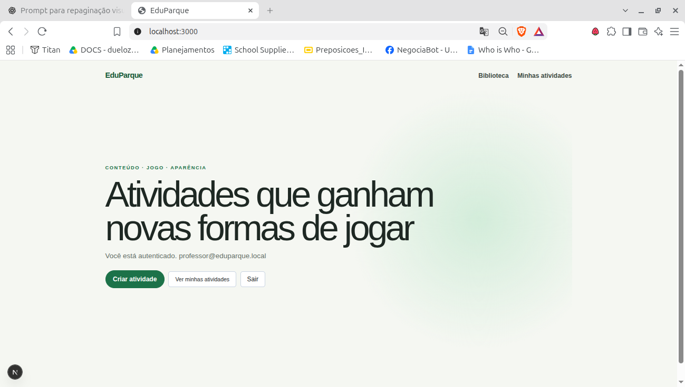
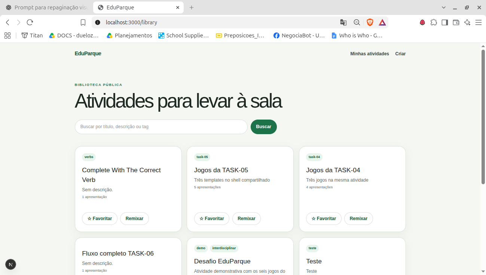
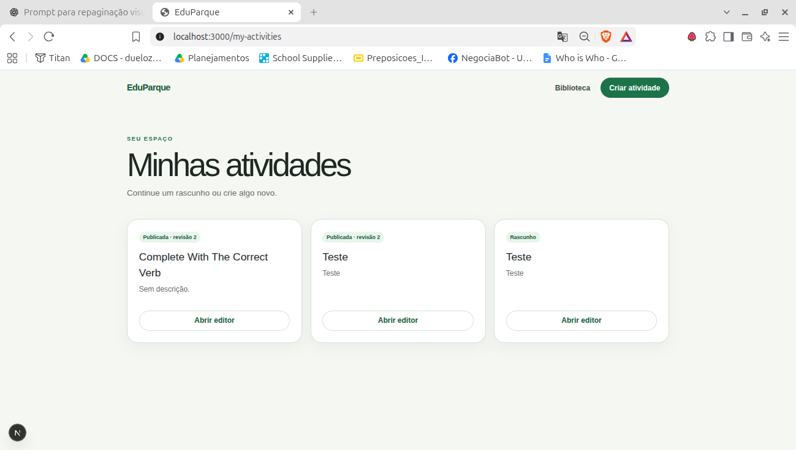
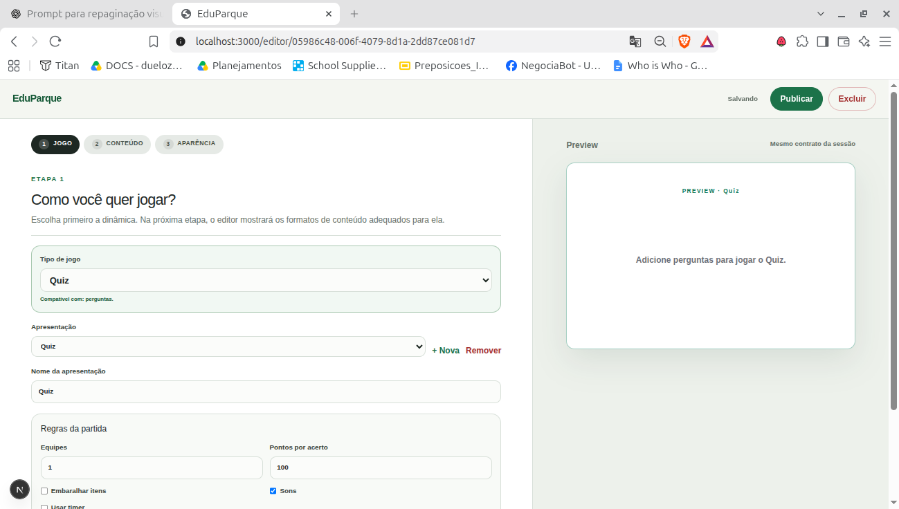
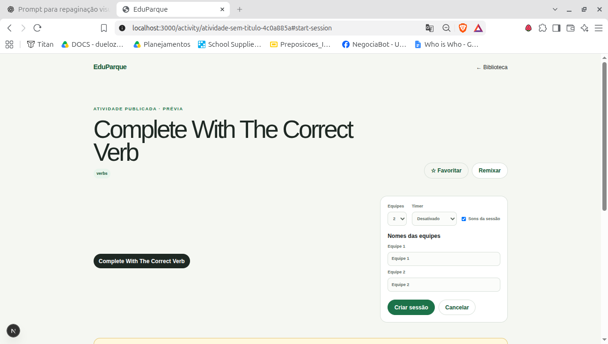
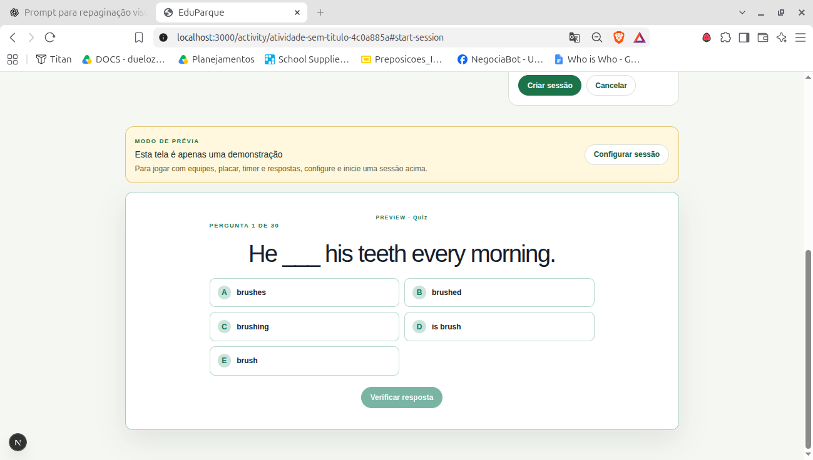
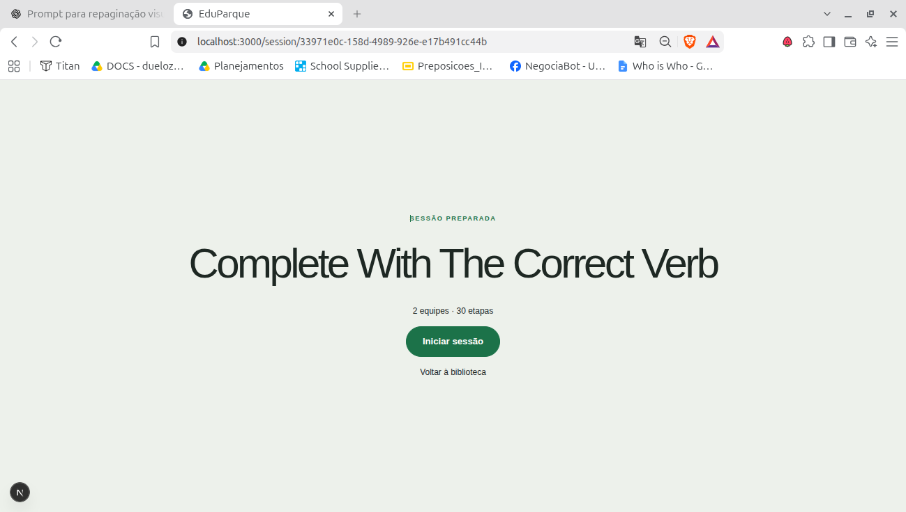
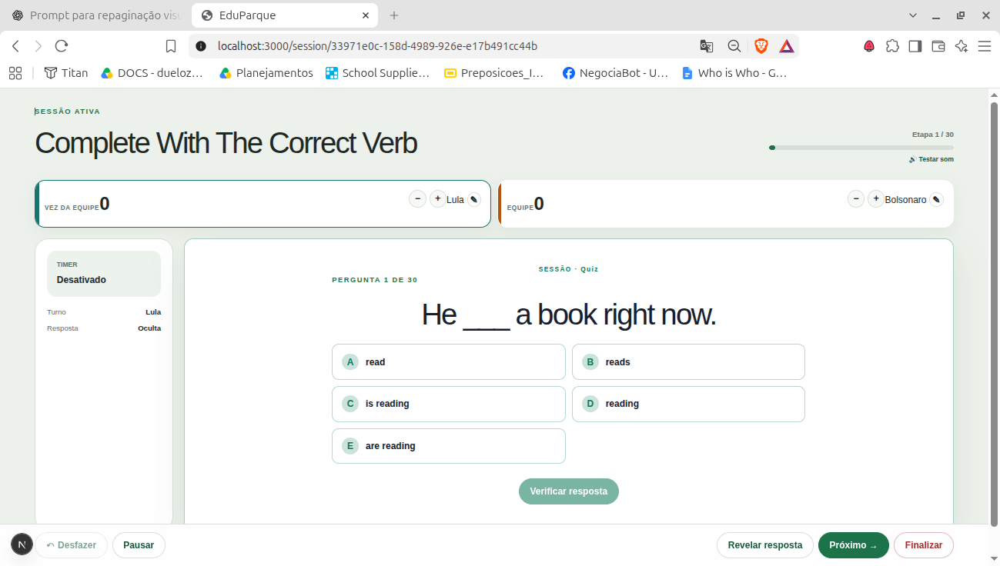

# EduParque — Plano de Repaginação Visual para Codex

**Projeto:** EduParque  
**Referência visual:** [Parque Biblioteca — Rede Areté](https://redearete.com/parque-biblioteca)  
**Stack informada:** React 19 · Next.js · Tailwind CSS  
**Versão:** 1.0 — 08/10/2026  
**Material de entrada:** 8 capturas da interface atual, anexadas em `assets/`.

> **Propósito:** transformar radicalmente a aparência e a experiência de uso do EduParque para que se reconheça a conexão com o Parque Biblioteca, preservando integralmente funcionalidades, contratos, estados e regras de negócio. Os prints documentam a interface atual; não são mockups de como o sistema deverá ficar.

## 1. Diagnóstico visual e rotas

| Rota / estado | Diagnóstico a partir dos prints | Objetivo da repaginação |
| --- | --- | --- |
| `/` | Hero com grande área ociosa, CTAs pequenos e pouca identidade | Home editorial, acolhedora e reconhecível |
| `/library` | Cards semelhantes, tipografia pequena e pouco contraste de prioridade | Catálogo educacional expressivo, claro e navegável |
| `/my-activities` | Rascunhos e publicações pouco diferenciados | Gestão de atividades com estados visuais claros |
| `/editor/[id]` | Densidade de campos, hierarquia limitada, preview secundário | Editor em etapas com preview valorizado |
| `/activity/[slug]` (configuração) | Ações e informações afastadas entre si | Jornada clara de apresentação → configuração → sessão |
| `/activity/[slug]` (preview) | Visualização simples e afastada dos controles | Prévia integrada à experiência real do jogo |
| `/session/[id]` (preparada) | Ocupação insuficiente do viewport | Abertura de jogo imersiva |
| `/session/[id]` (ativa) | Placar, controles, timer e questão competem visualmente | Interface legível à distância para sala e projetor |

**Atenção:** os nomes das rotas são inferidos dos screenshots; o Codex deve confirmar os caminhos reais no código. Imagens e screenshots não provam por si só toda a funcionalidade existente.

## 2. Configuração e ordem de execução

| Nº | Prompt | Reasoning sugerido | Modalidade |
| --- | --- | --- | --- |
| 1 | Auditoria visual, técnica e plano | **Extra High** | **Plan**, sem editar código |
| 2 | Design System e estrutura global | **High** | Implementação |
| 3 | Home | **High** | Implementação |
| 4 | Biblioteca + Minhas atividades | **Medium** | Implementação |
| 5 | Editor de atividades | **Extra High** | Implementação sensível |
| 6 | Página da atividade e preparação | **High** | Implementação |
| 7 | Sessão preparada + sessão ativa | **Extra High** | Implementação sensível |
| 8 | QA, responsividade e regressão | **High** | Auditoria + correções |

**Como utilizar:** execute **um prompt por vez**, preferencialmente no mesmo branch. Revise diffs e execute o fluxo real após cada etapa. Comece pelo Prompt 1 em modo Plan. A documentação gerada em `docs/redesign/` deve ser lida por todos os prompts seguintes. Se a referência online não estiver acessível ao Codex, forneça capturas do site original; não peça que ele invente detalhes que não viu.

**Preservação obrigatória em todas as etapas:** não alterar APIs, contratos, banco de dados, autenticação, persistência, estados de sessão, regras dos jogos, pontuação, turnos, timers ou fluxos funcionais sem necessidade comprovada e autorização. Não substituir dados reais por mocks. Não remover handlers para facilitar o redesign.

---

## 3. Prompt 1 — Auditoria visual e plano de migração

**Reasoning: High**  
**Modo: Plan (somente análise e documentação).**

**Material visual para analisar:** todas as imagens da pasta `assets/`.

```text
Quero realizar uma REPAGINAÇÃO VISUAL COMPLETA do EduParque.

STACK INFORMADA:
- React 19;
- Next.js;
- Tailwind CSS.

REFERÊNCIA PRINCIPAL:
https://redearete.com/parque-biblioteca

O EduParque deve parecer uma extensão digital do Parque Biblioteca da Rede Areté, sem ser uma cópia literal ou uma landing page institucional.

NESTA EXECUÇÃO, NÃO ALTERE O CÓDIGO DA APLICAÇÃO.

1. INVESTIGUE A REFERÊNCIA
Acesse o site oficial usando os recursos de navegação disponíveis e examine:
- tipografia (famílias, pesos, escala e hierarquia);
- cores e proporção entre cores de destaque e fundos neutros;
- fotografias e tratamento de imagem;
- header, navegação e CTAs;
- grids, espaçamentos e alinhamentos;
- superfícies, formas e padrões geométricos;
- composição editorial;
- comportamento no mobile.

Se houver navegador disponível, capture screenshots desktop/mobile da referência. Diferencie observações confirmadas de aproximações. Se o site não estiver acessível, documente a limitação e peça referências complementares: não afirme ter inspecionado o que não conseguiu visualizar.

2. AUDITE O REPOSITÓRIO
Confirme a stack real, versão do Tailwind e bibliotecas existentes.
Mapeie:
- rotas e layouts;
- componentes compartilhados e específicos;
- tokens e CSS globais;
- dependências e ícones;
- estados de interface;
- chamadas e contratos funcionais envolvidos nas telas.

Investigue especialmente as rotas observadas nos prints:
/
/library
/my-activities
/editor/[id]
/activity/[slug]
/session/[id]

Confirme os nomes de rota e descubra os demais estados/telas relevantes.

3. DIAGNOSTIQUE CADA TELA
Para cada rota, documente:
- usuário e objetivo da página;
- ação principal e ações secundárias;
- elementos de UI;
- estados possíveis;
- problemas concretos de hierarquia, legibilidade e responsividade;
- riscos de regressão;
- componentes que podem ser compartilhados.

Use os prints em assets/ como evidência do estado atual.

4. PROPOSTA DE IDENTIDADE
Defina uma direção para a interface que combine:
- linguagem institucional contemporânea;
- cultura, educação e comunidade;
- composição editorial e elementos visuais do Parque Biblioteca;
- experiência interativa e gamificação sem infantilização;
- produtividade do professor;
- legibilidade para alunos, inclusive em projeção.

Evite dashboards SaaS genéricos, excesso de cinza, cards idênticos e aplicação aleatória de cores.

5. PRESERVAÇÃO FUNCIONAL
A refatoração deve preservar:
- autenticação/autorização;
- backend e APIs;
- models, schemas, dados e persistência;
- editor e publicação;
- favoritos e remixagem;
- criação e execução de sessões;
- lógica dos jogos, pontuação, turnos e timers;
- estados e ações existentes.

6. ENTREGÁVEIS
Crie, sem alterar arquivos funcionais:
- docs/redesign/visual-audit.md
- docs/redesign/design-spec.md
- docs/redesign/implementation-plan.md

O plano deve especificar:
- princípio visual e tokens sugeridos;
- componentes a adaptar/criar;
- etapas e arquivos por rota;
- critérios de aceite;
- testes por etapa;
- riscos e decisões pendentes.

PARE após apresentar o plano. Aguarde aprovação para implementar.
```

---

## 4. Prompt 2 — Design System e estrutura global

**Reasoning: Medium**  
**Âmbito:** estilos globais, tokens, componentes compartilhados, navegação e app shell.

```text
Implemente a FASE 2 da repaginação do EduParque, conforme o plano aprovado.

LEITURA OBRIGATÓRIA:
- docs/redesign/visual-audit.md
- docs/redesign/design-spec.md
- docs/redesign/implementation-plan.md

REFERÊNCIA:
https://redearete.com/parque-biblioteca

OBJETIVO
Criar um Design System próprio para o EduParque, coerente com a linguagem visual da Rede Areté / Parque Biblioteca. Não criar um dashboard SaaS genérico.

1. TOKENS
Centralize em locais apropriados à stack real:
- backgrounds e surfaces;
- foreground e foreground-muted;
- primary, secondary e respectivas cores de contraste;
- cores semânticas de sucesso, alerta e erro;
- cores de destaque inspiradas na referência;
- border, radius, spacing, shadow, typography e motion.

Não invente cores oficiais. Use valores verificados na referência ou aproxime-os explicitamente como decisão de design. Não espalhe hexadecimais arbitrários entre componentes.

2. TIPOGRAFIA
Defina uma escala semântica consistente para display, h1, h2, h3, body, label e caption. Priorize leitura e personalidade editorial. Se for introduzir uma fonte, considere next/font e verifique desempenho/licença.

3. COMPONENTES COMPARTILHADOS
Reestilize/adapte componentes existentes, evitando duplicação:
Button, Card, Badge, Input, Textarea, Select, Checkbox, Modal, Dropdown, Tabs, Progress, Alert, EmptyState, Skeleton, PageHeader, SectionHeader.
Crie variantes apenas quando existir necessidade concreta.

Estados exigidos: default, hover, active, focus-visible, disabled, loading e erro, conforme cada componente.

4. APP SHELL
Repagine header, menu, container, espaçamentos e backgrounds. Mantenha links, permissões e ações reais. Desktop e mobile precisam de navegação apropriada; não introduza sidebar pesada se não houver necessidade.

5. ACESSIBILIDADE
- contraste preferencialmente WCAG AA;
- labels e semântica HTML;
- navegação por teclado;
- foco visível;
- alvos de toque confortáveis;
- suporte a prefers-reduced-motion.

6. RESTRIÇÕES
Nesta fase, NÃO redesenhe a estrutura específica de cada página. Não modifique lógica de negócio, APIs, contratos, autenticação ou dados. Não use assets externos sem autorização de uso e não substitua componentes funcionais por mocks.

7. ENTREGA
Execute lint, typecheck, testes e build existentes, conforme scripts do projeto. Registre comandos realmente executados e resultados. Relate arquivos alterados, tokens, componentes, riscos e pendências.

Finalize exclusivamente o Design System e o app shell.
```

---

## 5. Prompt 3 — Home `/`

**Reasoning: Medium**



*Print 01 — Home: hero com muito espaço ocioso, CTAs pouco expressivos e identidade visual ainda discreta.*

```text
Repagine a HOME (rota /) do EduParque com base no Design System aprovado em docs/redesign.

OBJETIVO
Criar uma home editorial e educacional, visualmente conectada ao Parque Biblioteca da Rede Areté, sem perder a objetividade de um sistema de atividades.

PROBLEMAS OBSERVADOS
- excesso de espaço vazio;
- composição textual isolada;
- ações primárias pequenas;
- pouca presença gráfica/institucional;
- identificação do usuário competindo com o conteúdo principal.

IMPLEMENTAÇÃO
1. Hero: crie uma composição forte e responsiva, com título, apoio textual curto, ação primária de destaque e ações secundárias identificáveis. Considere composição assimétrica, respeitando a referência.
2. Identidade: use cor, geometria e ritmo editorial do Parque Biblioteca. Utilize somente assets disponíveis e autorizados. Não invente fotos ou estatísticas.
3. Personalização: preserve o estado autenticado, mas apresente e-mail/identificação com menor hierarquia.
4. Ações: mantenha Criar atividade, Ver minhas atividades, Biblioteca e Sair, com URLs e handlers inalterados.
5. Navegação: aplique o app shell criado; não crie menus ou seções sem função real.
6. Mobile: priorize título, CTA e navegação; evite banners cortados e grandes áreas vazias.

CRITÉRIOS DE ACEITE
- conexão visual imediata com o EduParque/Parque Biblioteca;
- CTA principal óbvio;
- composição expressiva sem poluição;
- acessibilidade e responsividade;
- ações e autenticação intactas.

Trabalhe somente nesta rota e execute as verificações pertinentes.
```

---

## 6. Prompt 4 — Biblioteca e Minhas atividades

**Reasoning: Light**  
**Rotas:** `/library` e `/my-activities`.



*Print 02 — Biblioteca: lista de atividades com cards uniformes, busca e ações de favoritar/remixar.*



*Print 03 — Minhas atividades: cards de publicadas e rascunhos, cada um com ação Abrir editor.*

```text
Repagine /library e /my-activities utilizando o Design System documentado em docs/redesign.

OBJETIVO
Transformar a biblioteca em um catálogo educacional claro e visualmente expressivo, e Minhas atividades em uma área prática de gerenciamento.

1. BIBLIOTECA
- reestruture a hierarquia de cabeçalho, título, descrição e busca;
- preserve pesquisa por título, descrição e tag;
- melhore leitura dos títulos e descrições;
- destaque metadados realmente úteis, incluindo tags e quantidade de apresentações;
- mantenha Favoritar, Remixar e abertura da atividade, preservando handlers.

2. CARDS
- projete um componente reutilizável de atividade;
- evite alturas artificialmente grandes para conteúdos curtos;
- trate textos longos, tags múltiplas e descrições ausentes;
- crie estados hover/focus e feedback visual;
- use cores por significado, e não de forma aleatória;
- mantenha ritmo de grid responsivo sem overflow.

3. MINHAS ATIVIDADES
- destaque a diferença entre rascunho, publicada e revisão quando esses estados existirem;
- preserve Criar atividade e Abrir editor;
- evite que o badge de estado seja a única informação sobre publicação;
- não invente filtros, categorias ou contadores não suportados.

4. ESTADOS
Projete e valide estados de loading, vazio, erro, resultado de busca vazio, muitos itens e título longo.

5. TÉCNICA
- reaproveite componentes compartilhados;
- não altere queries, mutations, contratos, regras de publicação, favoritação ou remixagem;
- não substitua dados dinâmicos por conteúdo hardcoded.

CRITÉRIOS DE ACEITE
Catálogo organizado, estados claros, cards consistentes, ações identificáveis, layout responsivo e comportamento funcional preservado.

Finalize apenas essas duas rotas.
```

---

## 7. Prompt 5 — Editor de atividades

**Reasoning: High**  
**Rota:** `/editor/[id]`.



*Print 04 — Editor: etapas Jogo / Conteúdo / Aparência, configurações e painel de preview.*

```text
Repagine COMPLETAMENTE a interface visual do editor de atividades do EduParque.

ROTA: /editor/[id]
LEITURA: todos os documentos aprovados em docs/redesign.
RISCO FUNCIONAL: ALTO. Preserve cada comportamento antes de substituir a composição visual.

OBJETIVO
Criar um editor de atividades claro, visual, eficiente e coerente com o Parque Biblioteca, com prévia valorizada e etapas facilmente compreensíveis.

1. AUDITORIA PRÉVIA
Antes de modificar, identifique os fluxos existentes de:
- seleção do jogo;
- apresentações e seus tipos;
- conteúdo e perguntas;
- configurações de equipes e pontuação;
- embaralhamento;
- timer e sons;
- aparência;
- preview;
- autosave e sinalização de salvamento;
- publicação, exclusão e validação.
Mapeie também estados que não aparecem no screenshot.

2. ESTRUTURA DESKTOP
Crie composição clara com:
- barra superior e ações de salvar/publicar/excluir;
- indicador das etapas JOGO, CONTEÚDO e APARÊNCIA;
- painel de edição bem organizado;
- painel de preview com destaque e proporção adequada;
- boa divisão de tarefas entre controles e visualização.

3. ESTRUTURA MOBILE
O editor deve continuar usável em tela pequena: edição em largura integral, preview acessível, ações de navegação e publicação encontráveis, sem scroll horizontal.

4. FORMULÁRIOS
Agrupe configurações relacionadas. Reestilize selects, inputs, checkboxes e controles de adição/remoção sem esconder funções essenciais em menus pouco óbvios.

5. PREVIEW FIEL
Mantenha a prévia conectada ao componente/lógica real de apresentação. Evite criar uma segunda implementação de jogo apenas para gerar aparência visual.

6. ESTADOS
Trate explicitamente: salvando, salvo, erro de salvamento, atividade vazia, prévia sem conteúdo, erro de validação e publicação.

7. REGRAS DE SEGURANÇA DA REFATORAÇÃO
NÃO ALTERE:
- handlers e hooks funcionais;
- payloads e contratos;
- validações de negócio;
- estruturas das perguntas;
- autosave;
- publicação/exclusão;
- timers;
- pontuação;
- tipos de jogos e apresentações.
Não faça refatoração ampla de lógica fora do escopo visual.

8. TESTES
Verifique no fluxo real: abrir atividade, trocar etapas, editar campos, adicionar/remover apresentação, salvar, recarregar, pré-visualizar e publicar. Execute scripts de lint, TypeScript, teste e build disponíveis. Relate o que foi e não foi efetivamente verificado.

CRITÉRIOS DE ACEITE
Editor visualmente transformado, preview relevante, configurações agrupadas, etapas claras, mobile utilizável e nenhuma funcionalidade removida.

Finalize somente /editor/[id].
```

---

## 8. Prompt 6 — Atividade, preview e preparação de sessão

**Reasoning: Medium**  
**Rota:** `/activity/[slug]`.



*Print 05 — Página da atividade: título, ações, configuração de equipes, timer e início de sessão.*



*Print 06 — Prévia de quiz: questão, alternativas e ação Verificar resposta.*

```text
Repagine a interface da atividade publicada e de preparação da sessão.

ROTA: /activity/[slug]
Leia docs/redesign e utilize os componentes aprovados.

OBJETIVO
Organizar uma jornada simples: CONHECER A ATIVIDADE → VISUALIZAR → CONFIGURAR → INICIAR A SESSÃO.

1. HERO DA ATIVIDADE
Apresente com boa hierarquia:
- título;
- informações relevantes;
- tags reais;
- Favoritar e Remixar;
- retorno à biblioteca.
Aplique linguagem editorial e identidade EduParque, sem transformar a página em landing page desconectada da função.

2. CONFIGURAÇÃO
Reorganize em painel funcional e legível:
- quantidade de equipes;
- timer;
- sons;
- nomes das equipes;
- Criar sessão e Cancelar.
Preserve os valores e validações existentes.

3. PREVIEW
Valorize a área de prévia da atividade. Se possível, utilize o mesmo componente que renderiza a experiência de jogo. Diferencie claramente MODO DE PRÉVIA de SESSÃO ATIVA.

4. DISTRIBUIÇÃO
Evite grandes distâncias verticais injustificadas entre configuração e preview. No desktop, busque composição equilibrada; no mobile, use ordem de leitura natural e CTA acessível.

5. NAVEGAÇÃO
Preserve rotas e âncoras existentes, inclusive #start-session se realmente usado. Preserve todos os links e handlers reais.

6. RESTRIÇÕES
Não altere criação de sessões, controle de equipes, lógica de timer/som, favoritação, remixagem, preview, estado das questões ou regras de jogo.

7. VALIDAÇÃO
Confirme: exibição de uma atividade real, preview navegável, configuração válida, criação de sessão e transição correta para /session/[id].

Finalize somente a página da atividade.
```

---

## 9. Prompt 7 — Sessão preparada e sessão ativa

**Reasoning: High**  
**Rota:** `/session/[id]`.  
**Critério dominante:** legibilidade e organização para uso em sala, TV ou projetor.



*Print 07 — Sessão preparada: título central, equipes/etapas e botão Iniciar sessão.*



*Print 08 — Sessão ativa: placar por equipe, indicador de turno, timer, questão, alternativas e barra de ações.*

```text
Repagine a EXPERIÊNCIA DE SESSÃO do EduParque de forma completa.

ROTA: /session/[id]
LEITURA OBRIGATÓRIA: docs/redesign/*
RISCO FUNCIONAL: MUITO ALTO. Preserve a lógica de gameplay.

OBJETIVO
Criar uma experiência de jogo educacional imersiva, legível à distância, coerente com a identidade da Rede Areté / Parque Biblioteca e utilizável pelo professor em sala.

PRINCÍPIO DE HIERARQUIA
1. Pergunta / conteúdo principal;
2. Alternativas e interação;
3. Placar e equipe da vez;
4. Progresso e timer;
5. Comandos operacionais do professor.

1. INVESTIGAÇÃO
Mapeie todos os estados implementados de sessão: preparada, iniciada, rodada ativa, alternância de turno, seleção, resposta verificada, resposta revelada, pausa, retomada, conclusão e resultado final. Não invente estados de negócio.

2. SESSÃO PREPARADA
Redesenhe como abertura de uma atividade interativa:
- título da atividade em destaque;
- número de equipes;
- quantidade de etapas;
- botão Iniciar sessão com destaque inequívoco;
- composição visual marcante e responsiva.
Evite viewport quase vazio. Preserve a ação de voltar à biblioteca.

3. SESSÃO ATIVA
Repagine o layout para que a pergunta seja o elemento dominante. Use um design adequado à projeção em 1366x768 e 1920x1080, sem depender exclusivamente dessas resoluções. Preserve responsividade em tablet/mobile.

4. PLACAR
Crie placar legível com:
- nomes de equipes (incluindo nomes longos);
- pontuação;
- equipe da vez;
- controles de ajuste existentes;
- estados de destaque.
Não permita sobreposição entre texto, placar e controles. Não altere regras de pontuação.

5. PERGUNTAS
Adote tipografia legível à distância; trate conteúdo curto e longo. Mantenha as configurações e formatos de jogos que realmente existirem.

6. ALTERNATIVAS
Use superfícies clicáveis amplas, espaçamento confortável e estados visuais claros:
- normal;
- hover/focus;
- selecionada;
- correta;
- incorreta;
- bloqueada/revelada, quando aplicável.
Não dependa somente de cor para sinalizar os resultados. Não mude critérios de correção.

7. TIMER
Integre o timer visualmente, preservando a fonte de tempo e regras reais. Não crie contagens locais independentes incompatíveis com o estado do backend. Mantenha pausa/retomada/expiração existentes.
Não implemente nesta fase um timer de bomba; apenas evite um layout que impeça esse tipo de animação futura.

8. PROGRESSO
Apresente questão atual/total de forma clara, sem competir com a questão principal.

9. CONTROLES OPERACIONAIS
Preserve todas as ações existentes:
- Desfazer;
- Pausar/Retomar;
- Revelar resposta;
- Próximo;
- Finalizar;
- controles de pontuação;
- controles de som.
Agrupe-as em barra responsiva e sem sobreposição do conteúdo. Destaque ações destrutivas de modo adequado.

10. MICROINTERAÇÕES
Inclua feedback discreto na seleção, progressão e mudança de turno, preferencialmente por CSS. Respeite reduced motion e mantenha o foco na atividade pedagógica.

11. RESTRIÇÕES
NÃO ALTERAR:
- backend e persistência;
- pontuação;
- turnos;
- correção;
- progressão;
- pausa/retomada;
- timers;
- áudio;
- finalização;
- sincronização;
- regras específicas dos tipos de jogo.
Não substitua componentes reais por mockups estáticos.

12. TESTES
Teste os fluxos realmente disponíveis: preparar, iniciar, selecionar, verificar, revelar, ajustar pontos, avançar, pausar, retomar, desfazer, finalizar e reabrir. Teste nomes longos, vários tamanhos de questão e diferentes quantidades de alternativas/equipes.

CRITÉRIOS DE ACEITE
Sessão visualmente transformada, pergunta em primeiro plano, placar limpo, controles utilizáveis, boa leitura em projetor, mobile funcional e gameplay preservado.

Finalize somente /session/[id].
```

---

## 10. Prompt 8 — QA visual, responsividade e regressão

**Reasoning: Medium'**

```text
Realize a auditoria final da repaginação visual do EduParque e corrija somente problemas pertencentes ao escopo do redesign.

LEITURA OBRIGATÓRIA:
docs/redesign/visual-audit.md
docs/redesign/design-spec.md
docs/redesign/implementation-plan.md

1. REVISÃO DE ROTAS
Inspecione todas as rotas existentes e, em especial:
/
/library
/my-activities
/editor/[id]
/activity/[slug]
/session/[id]

2. CONSISTÊNCIA
Valide:
- cores e tokens semânticos;
- tipografia e escala;
- espaçamentos e alinhamentos;
- botões, badges, cards e inputs;
- radius, sombras e superfícies;
- navegação, foco e feedback;
- identidade visual reconhecível do EduParque.

3. RESPONSIVIDADE
Se houver ferramentas, teste no mínimo:
375x812
768x1024
1366x768
1920x1080

Investigue overflow, corte de texto, sobreposição, modais, barras fixas, formulários, placares, perguntas e alternativas.

4. ACESSIBILIDADE
Verifique contraste, foco visível, labels, HTML semântico, teclado, alvos de toque, reduced motion e estados que não dependem exclusivamente de cor.

5. REGRESSÃO FUNCIONAL
Valide a funcionalidade real de:
- navegação e autenticação;
- busca;
- atividades;
- favoritos e remixagem;
- edição e autosave;
- publicação;
- preview;
- configuração/criação de sessão;
- início, pontuação, timer, turnos e finalização da sessão.

6. QUALIDADE TÉCNICA
Descubra os comandos verdadeiros no package.json e execute as verificações existentes de lint, typecheck, testes e build. Não oculte erros com any, ts-ignore ou desativação indiscriminada do lint.

7. COMPARAÇÃO VISUAL
Quando houver browser, capture screenshots das versões finais em desktop/mobile e compare com os 8 prints de assets/ fornecidos no briefing, além da referência oficial. Aponte avanços e inconsistências concretas.

8. RELATÓRIO
Crie docs/redesign/final-review.md com:
- páginas revisadas;
- problemas encontrados/corrigidos;
- comandos executados e resultados reais;
- lacunas de teste;
- riscos restantes;
- recomendações futuras.

Não afirme que uma página foi validada no navegador caso não tenha sido. Não altere regras de negócio para forçar testes. Entregue uma versão visualmente consistente e funcional.
```

---

## 11. Prompt adicional — Correção de rumo visual (quando necessário)

Use **somente se o Codex entregar uma interface genérica ou uma simples troca de cores**. Reasoning sugerido: **Medium ou High**, dependendo do número de componentes afetados.

```text
A implementação atual está superficial: houve troca de cor e de bordas, mas não uma transformação perceptível da composição visual.

Reanalise o Design System aprovado e o site do Parque Biblioteca.

Ajuste a hierarquia, ritmo visual, tipografia, aproveitamento de espaço e identidade gráfica. Compare o estado anterior com o estado atual em desktop e mobile.

Não preserve layouts antigos apenas porque funcionam: preserve sua funcionalidade, mas reavalie a apresentação.

Não crie um template SaaS genérico nem uma cópia estática do site institucional.

Mantenha APIs, dados, contratos, handlers e regras de jogo intactos. Trabalhe somente nos componentes visuais da etapa atual.
```

## 12. Checklist operacional de entrega

- [ ] Branch ou commit de segurança criado antes da repaginação.
- [ ] Prompt 1 concluído e plano revisado.
- [ ] Tokens e componentes compartilhados aprovados.
- [ ] Home funcional em desktop/mobile.
- [ ] Biblioteca e Minhas atividades funcionais.
- [ ] Editor testado com atividade real, salvamento e publicação.
- [ ] Preview e configuração da atividade testados.
- [ ] Sessão preparada, sessão ativa e controles testados.
- [ ] Verificações de lint, tipos, testes e build executadas.
- [ ] Screenshots comparativos finais capturados quando possível.
- [ ] Relatório `docs/redesign/final-review.md` elaborado.

## 13. Observações para uso no repositório

1. Esta pasta contém o Markdown e os **8 prints reais enviados pelo solicitante**, preservados sem alteração visual.
2. As imagens estão em `assets/`, com nomes correspondentes a suas rotas/estados. **Mantenha essa pasta junto do Markdown** para que os links relativos funcionem.
3. Se o Codex não enxergar imagens referenciadas em Markdown no ambiente dele, **anexe os screenshots diretamente na conversa do Codex**.
4. O documento não contém capturas do site oficial da Rede Areté. Para maior fidelidade, adicione imagens de referência do site original capturadas pelo próprio navegador/Codex e com uso autorizado.
5. Estes prompts são diretrizes. O Codex deve confirmar a estrutura real do repositório, jamais supor arquivos, funções ou rotas inexistentes.
